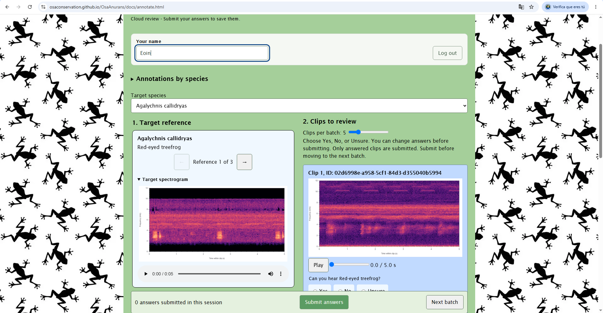
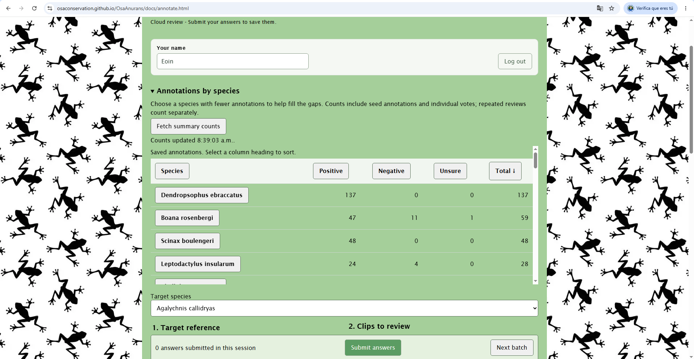
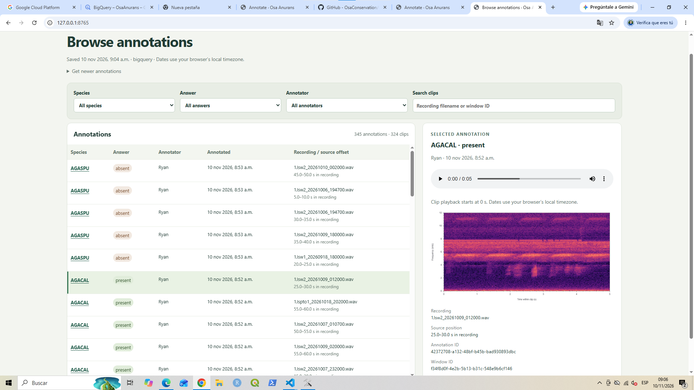

# Osa Anurans

Tools for finding and labeling frog calls:

- **Website:** listen to clips and label whether a species is present.
- **Console app:** import recordings, train a classifier, and send clips to the website.

## Use the website

Open the [annotation page](https://osaconservation.github.io/OsaAnurans/docs/annotate.html).

1. Enter the shared annotator password and your name.
2. Choose a species and the number of clips to review.
3. Listen to its reference clips. Use the arrows to switch references.
4. Choose **Yes**, **No**, or **Unsure** for each candidate.
5. Click **Submit answers**, then **Next batch**.



- Template references appear first; older references remain available.
- Spectrograms are generated from audio when no image is supplied.
- Summary counts load only when you click **Fetch summary counts**.
- Switching species keeps each species' current batch and answers during this page session.
- Reloading clears your name, session, batch position, and unsent answers.

<details>
<summary>See annotation counts by species</summary>

Click **Fetch summary counts** to see saved answers by species. The screenshot
shows an example; counts change as annotations are added.



</details>

### Run the website locally

From the repository root:

```powershell
cd C:\OsaAnurans
python -m http.server 8000 --bind 127.0.0.1
```

- Open [localhost:8000/docs/annotate.html](http://localhost:8000/docs/annotate.html).
- Stop the server with **Ctrl+C**.
- API settings are in [docs/annotation-config.js](docs/annotation-config.js).
- The default uses the **live cloud API**. Answers submitted locally are real annotations.
- The frontend is plain HTML/JavaScript; no build command is needed. Test locally before publishing.

## Use the console app

Run these commands from the repository root on Windows. Install
[Python 3.11](https://www.python.org/downloads/), [uv](https://docs.astral.sh/uv/),
and the Google Cloud CLI first.

```powershell
cd C:\OsaAnurans
uv sync --project osa_anurans_app --locked
gcloud auth application-default login
.\osa_anurans_app\.venv\Scripts\python.exe -m osa_anurans_app.src.cli
```

- Cloud steps need Google Cloud access to this project's data and the `gcloud` CLI.
- Put new recordings in `osa_anurans_app/inputs/audio-inbox/`.
- In the menu, use **Up/Down** to move and **Space** to choose steps.
- Select **Continue**, review the plan, then choose **Start workflow**.
- All selected steps run without further prompts.

**Typical run:** fetch annotations, train, generate candidates, and upload. Add **Import new
audio** when you have new recordings.

- Training alone saves the model and test results; candidate generation is a separate choice.
- Uploading replaces the website's candidate queue and keeps existing annotations.
- The first embedding run downloads about 414 MB of model weights.
- Keep `osa_anurans_app/outputs/`; it contains your local audio, embeddings, and models.

See the [app guide](osa_anurans_app/README.md) for setup, labeled-audio examples,
settings, and individual commands.

### Browse saved annotations

```powershell
.\osa_anurans_app\.venv\Scripts\python.exe -m osa_anurans_app.src.cli browse
```

Open the printed local URL to filter individual answers by species, response, or
annotator, listen to their clips, and generate spectrograms. This uses saved
annotations and local audio; browsing needs no cloud login. Use the existing
`refresh` command first for newer answers, then restart the browser server.
Stop with **Ctrl+C**. See the [browser instructions](osa_anurans_app/README.md#browse-saved-annotations).



## Find the code

- [docs/](docs/): website HTML, JavaScript, and spectrogram rendering.
- [osa_anurans_app/src/](osa_anurans_app/src/): console app and local model workflow.
- [cloud/annotationservice/](cloud/annotationservice/): password-protected Cloud Run API.
- [API guide](cloud/annotationservice/README.md): endpoints and backend deployment.
- [Storage migration guide](cloud/storage-migration/README.md): move audio to `us-east1`.

## Run checks

```powershell
# Console app
.\osa_anurans_app\.venv\Scripts\python.exe -m pytest osa_anurans_app/tests -q

# Website JavaScript; requires Node.js
node --test tests/*.test.mjs
```

- App tests use small test embeddings and fake cloud clients.
- Browser checks are in `tests/*.browser.py`; they require Playwright and Microsoft Edge.
- Backend setup and tests are described in the [API guide](cloud/annotationservice/README.md).
